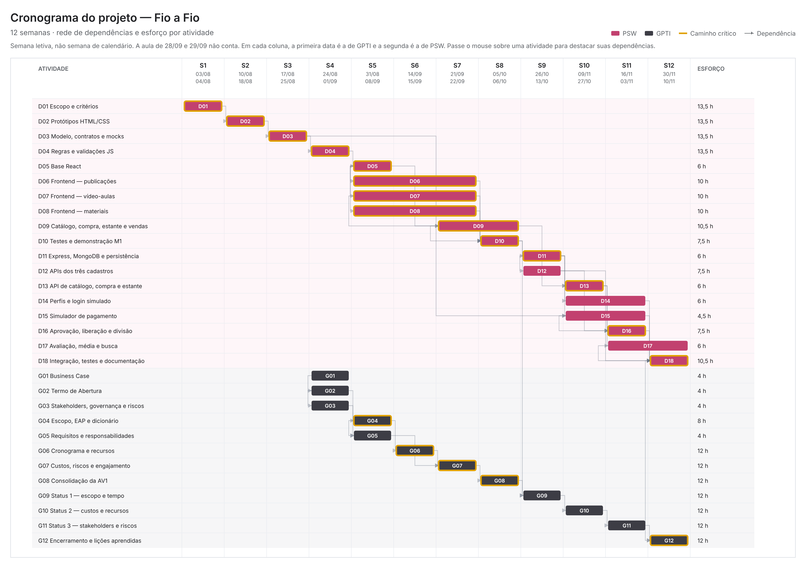
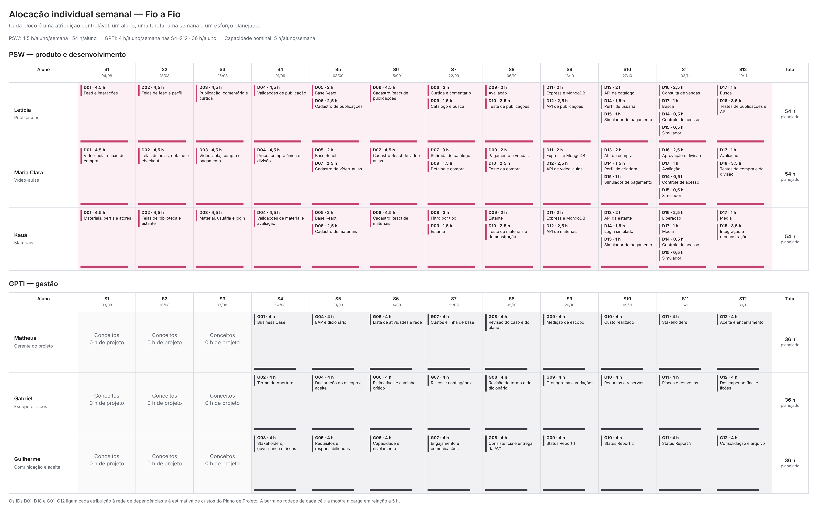

# Plano de Projeto — Fio a Fio

**Versão:** 1.0 — linha de base fechada para a AV1  
**Data:** 05/10/2026  
**Patrocinador:** Prof. Diogo Mendonça  
**Equipe:** 3 alunos de PSW (produto e desenvolvimento) e 3 alunos de GPTI (gestão e validação interna do escopo)

> Este documento contém a declaração do escopo, os requisitos, a matriz de rastreabilidade, a EAP, o cronograma, os recursos, os custos, os riscos, o engajamento e o registro de uso de IA. O dicionário da EAP, com aceite de cada pacote, está em [dicionario-eap.md](dicionario-eap.md). Equipe PSW: Letícia Mendonça dos Santos (coordenadora), Maria Clara Mousinho de Salles e Kauã Di Franco de Andrade Monteiro. Equipe GPTI: Matheus Cunha Schwab (gerente do projeto), Gabriel Barretto Galdino dos Santos e Guilherme Barboza Araújo de Almeida. Nas tabelas, cada pessoa aparece pelo primeiro nome.

**Números da linha de base**

| O quê | Valor | Onde |
|---|---:|---|
| Iniciação, ordem de grandeza | 390 h, R$ 7.350 (−25% a +75%) | Caso de negócio 12.1 |
| Capacidade dos calendários | 180 h PSW + 135 h GPTI = 315 h | 5.3 |
| Atividades niveladas | 162 h PSW + 108 h GPTI = 270 h, R$ 5.088,46 | 5.2, 6.2 |
| Segunda estimativa, pelo entregável | 251 h; PSW +9 h, GPTI −28 h | 6.2.1 |
| Contingência, por evento nomeado | 44 h = 18 h PSW + 26 h GPTI, R$ 829,23 | 6.3.3 |
| Linha de base de custos | 314 h, R$ 5.917,69 | 6.4 |
| Reserva gerencial, fora da linha de base | 7%, R$ 414,24 | 6.4 |
| Orçamento total simulado | R$ 6.331,93; desembolso R$ 0 | 6.4, termo 10 |
| Marcos | M1/AV1 na S8: GPTI 05/10 e PSW 06/10. M2 na S12: PSW 10/11; aceite GPTI 30/11 | 5.1 |

**Tecnologias**

| Camada | Tecnologia | Situação |
|---|---|---|
| Frontend | React 18, JavaScript (JSX), Vite 5 e React Router 6 | Em uso no repositório de PSW |
| Estilo | Tailwind CSS 3 | Em uso |
| Perfil simulado | React Context, com troca de perfil na interface | Em uso |
| Dados do marco 1 | Módulos JavaScript locais em `src/mocks`, lidos direto pelas telas | Em uso; não há servidor de dados simulado |
| Backend do marco 2 | JavaScript com Express e MongoDB | Previsto; ainda não iniciado. Confirmação em D11, na semana 9 |

## 1. Objetivo da EAP

Decompor o trabalho e as entregas do protótipo em componentes gerenciáveis, cobrindo os casos de uso priorizados. A EAP é orientada a entregas; a numeração representa a relação hierárquica, não uma sequência de execução.

O produto desta fase é um protótipo acadêmico. Os requisitos e as regras de compra são hipóteses definidas pelos alunos de PSW e validadas internamente pelos alunos de GPTI; nenhuma criadora, compradora ou fornecedor as aprovou.

Os itens numerados com quatro níveis, como 1.4.1.1, são atividades usadas no cronograma. O pacote de trabalho é o nível anterior, como 1.4.1. Aceite, fronteira e responsável por prestar contas estão no dicionário, não nesta árvore.

## 2. EAP / WBS

### 1.0 Projeto do protótipo Fio a Fio

- **1.1 Gestão e coordenação do projeto**
  - 1.1.1 Termo de abertura e plano de trabalho mantidos
  - 1.1.2 Backlog, decisões, riscos e mudanças acompanhados
  - 1.1.3 Demonstrações e aceites internos dos marcos registrados
  - 1.1.4 Atividades de aprendizagem, pareamento e revisão técnica organizadas

- **1.2 Requisitos e desenho funcional**
  - 1.2.1 Escopo funcional priorizado, proposto por PSW e validado por GPTI
  - 1.2.2 Atores, perfis simulados e fluxo de compra definidos para o protótipo
  - 1.2.3 Modelo de dados e contratos de API definidos
  - 1.2.4 Regras de pagamento simulado, liberação e divisão de receita definidas
  - 1.2.5 Hipóteses, regras pendentes e limitações documentadas
  - 1.2.6 Protótipos de tela e navegação revisados internamente

- **1.3 Base técnica e ambientes**
  - 1.3.1 Aplicação React/JavaScript inicializada com Vite, React Router e Tailwind CSS, com a identidade visual do projeto
  - 1.3.2 API JavaScript inicializada, prevista em Express
  - 1.3.3 Persistência configurada para desenvolvimento, prevista em MongoDB
  - 1.3.4 Dados simulados em módulos locais (`src/mocks`) preparados para o frontend do primeiro marco
  - 1.3.5 Cadastro e login simulados, sem credenciais ou dados reais
  - 1.3.6 Serviço de pagamento simulado, com resultado previsível
  - 1.3.7 Perfis de usuária e de criadora simulados e dados fictícios de demonstração

- **1.4 Marco 1 — Frontend dos fluxos priorizados, com dados simulados locais**
  - 1.4.1 Interface de publicações do feed construída
    - 1.4.1.1 Criar, consultar, editar e remover publicação
    - 1.4.1.2 Curtir e comentar publicação
  - 1.4.2 Interface de vídeo-aulas da criadora construída
    - 1.4.2.1 Cadastrar, consultar e editar vídeo-aula
    - 1.4.2.2 Retirar vídeo-aula do catálogo
  - 1.4.3 Interface de materiais gratuitos construída
    - 1.4.3.1 Cadastrar, editar e remover material
    - 1.4.3.2 Listar materiais e filtrar por tipo
  - 1.4.4 Interface de catálogo e detalhe da vídeo-aula construída
    - 1.4.4.1 Listar vídeo-aulas ofertadas
    - 1.4.4.2 Buscar por título e filtrar por nível de dificuldade
    - 1.4.4.3 Ver o detalhe da vídeo-aula
  - 1.4.5 Interface de compra, pagamento simulado e estante construída
    - 1.4.5.1 Iniciar a compra a partir do detalhe
    - 1.4.5.2 Informar o dado de teste e ver o resultado do pagamento
    - 1.4.5.3 Consultar a estante de aulas compradas
    - 1.4.5.4 Abrir a aula comprada
  - 1.4.6 Interface de avaliação e de vendas da criadora construída
    - 1.4.6.1 Avaliar a aula comprada
    - 1.4.6.2 Consultar vendas com a parte da criadora e a da plataforma
  - 1.4.7 Fluxos de frontend conectados aos dados simulados locais
  - 1.4.8 Demonstração do marco 1 e limitações dos dados simulados documentadas

- **1.5 Backend e regras de negócio**
  - 1.5.1 API de publicações implementada
    - 1.5.1.1 Operações de criar, consultar, editar e remover
    - 1.5.1.2 Curtida e comentário
  - 1.5.2 API de vídeo-aulas da criadora implementada
    - 1.5.2.1 Cadastro, consulta e edição pela dona
    - 1.5.2.2 Retirada do catálogo sem perda das compras
  - 1.5.3 API de materiais gratuitos implementada
  - 1.5.4 API de catálogo e busca implementada
    - 1.5.4.1 Consulta das vídeo-aulas ofertadas e do detalhe
    - 1.5.4.2 Busca por título e filtro por nível
  - 1.5.5 API de compra e estante implementada
    - 1.5.5.1 Criar a compra com o preço do momento
    - 1.5.5.2 Recusar compra da própria aula e compra repetida
    - 1.5.5.3 Consultar a estante
  - 1.5.6 Pagamento simulado e liberação implementados
    - 1.5.6.1 Enviar a compra ao simulador e receber aprovado ou recusado
    - 1.5.6.2 Liberar a aula somente com pagamento aprovado
  - 1.5.7 Divisão de receita e consulta de vendas implementadas
    - 1.5.7.1 Calcular e gravar a parte da criadora e a da plataforma
    - 1.5.7.2 Consultar as vendas da criadora
  - 1.5.8 API de avaliação implementada
  - 1.5.9 Login simulado e controle de acesso por perfil implementados
  - 1.5.10 Dados de domínio persistidos no banco de dados, previsto em MongoDB

- **1.6 Marco 2 — Sistema integrado ao backend próprio (Express/MongoDB previstos)**
  - 1.6.1 Frontend conectado às APIs do backend próprio
  - 1.6.2 Fluxos completos persistidos e recuperados do banco de dados
  - 1.6.3 Compra de ponta a ponta executada e demonstrada
  - 1.6.4 Divisão de 85% e 15% demonstrada na consulta de vendas
  - 1.6.5 Perfis de usuária e de criadora no fluxo integrado
  - 1.6.6 Erros e estados inválidos tratados nos fluxos prioritários
  - 1.6.7 Demonstração integrada final preparada

- **1.7 Verificação e encerramento acadêmico**
  - 1.7.1 Testes dos fluxos e regras de negócio prioritários executados
  - 1.7.2 Testes da compra, da liberação e da divisão documentados
  - 1.7.3 Defeitos prioritários corrigidos ou registrados como limitações conhecidas
  - 1.7.4 Instruções de instalação, configuração e execução documentadas
  - 1.7.5 Apresentação final, aceite interno e lições aprendidas registrados
  - 1.7.6 Pendências para um lançamento futuro registradas

## 3. Regras de negócio do protótipo

As regras abaixo detalham a definição do projeto feita por PSW e foram fechadas na validação interna do escopo. São regras do protótipo acadêmico e não devem ser apresentadas como política do produto até validação com criadoras, compradoras e fornecedores.

1. **Perfis:** há usuária e criadora. Toda criadora é usuária e mantém as funções comuns. No protótipo, a usuária ativa o perfil de criadora no próprio perfil, sem aprovação. O administrador da definição do projeto não tem função nesta fase.
2. **Vídeo-aula:** título, descrição, preço, duração, nível de dificuldade, capa e referência ao vídeo são obrigatórios. O preço é maior que zero, em reais, com duas casas. Só a criadora dona altera a sua vídeo-aula. O vídeo é um arquivo ou endereço fictício; não há hospedagem nem transmissão.
3. **Compra:** a compra liga uma usuária a uma vídeo-aula e guarda o preço do momento. Os estados são pendente, aprovada e recusada. A criadora não compra a própria aula. Quem já tem compra aprovada de uma aula não a compra de novo. Compra recusada pode ser tentada outra vez.
4. **Pagamento simulado:** o simulador recebe a compra e devolve aprovado ou recusado conforme o dado de teste informado, sempre com o mesmo resultado para o mesmo dado. Nenhum número de cartão é gravado.
5. **Pedido e liberação:** iniciar a compra não equivale a ter a aula. A aula entra na estante somente quando o pagamento é aprovado. O acesso liberado não expira.
6. **Divisão de receita:** na aprovação, a parte da plataforma é 15% do preço bruto, arredondada ao centavo. A parte da criadora é o preço menos a parte da plataforma, de modo que as duas somam o preço. Os dois valores ficam gravados na compra. Mudar o preço da aula depois não altera compras já feitas.
7. **Retirada de vídeo-aula:** vídeo-aula com compra aprovada não é apagada. Ela sai do catálogo e continua na estante de quem comprou.
8. **Avaliação:** só quem tem compra aprovada avalia. A nota vai de 1 a 5. Há uma avaliação por compradora por aula, que pode ser alterada. A média da aula é recalculada a cada avaliação.
9. **Publicações:** a autora cria, edita e remove as suas publicações. Qualquer usuária autenticada comenta e curte; cada usuária curte uma publicação uma só vez.
10. **Materiais gratuitos:** a usuária com perfil de criadora cadastra, edita e remove os seus materiais. Qualquer usuária autenticada consulta. O arquivo é fictício.

### 3.1 Dados de demonstração

Antes de cada demonstração, a equipe carrega um conjunto fixo de dados fictícios:

- Usuárias e criadoras, com perfil preenchido.
- Vídeo-aulas com preços diferentes, inclusive um preço cujos 15% não dão centavo exato.
- Materiais gratuitos de tipos diferentes e publicações com curtidas e comentários.
- Dados de teste do simulador de pagamento: um que aprova e um que recusa.

O conjunto é o mesmo nos módulos de `src/mocks` e no banco de dados do backend, para que o resultado da demonstração seja reproduzível.

### 3.2 Integrações fora do escopo deste projeto

- Não há conexão com provedor de pagamento, de identidade ou de hospedagem de vídeo. O pagamento e o login são simulados e os vídeos são fictícios.
- Cobrança real, estorno, repasse às criadoras, nota fiscal e conciliação exigem projeto ou etapa futura, com fornecedor contratado.
- O uso de dados pessoais reais ou a publicação para o público exige decisão própria e levantamento das obrigações legais.

## 4. Linha de base do escopo

A linha de base do escopo é a versão aprovada destes três artefatos: a declaração abaixo, a EAP da seção 2 e o [dicionário](dicionario-eap.md). Ela só muda por controle de mudanças. Cronograma e custo das seções seguintes descrevem este mesmo recorte, não o cenário de lançamento usado nos indicadores do caso de negócio.

### 4.1 Declaração do escopo

Entregar, em 12 semanas, um protótipo em que uma usuária fictícia encontra uma vídeo-aula, compra com pagamento simulado, vê a aula na estante e a avalia, e em que uma criadora fictícia cadastra suas vídeo-aulas e consulta suas vendas com a divisão de 85% e 15%. O protótipo inclui o feed de publicações e a biblioteca de materiais gratuitos. A equipe GPTI entrega os artefatos de gestão no calendário da disciplina. Pagamento real, hospedagem de vídeo, stories, seguidores, chat, notificações, trilhas e moderação permanecem fora.

Premissas que ainda valem: dados fictícios; pagamento e login simulados; três alunos de PSW programam e três de GPTI gerenciam; dedicação máxima de 5 h/semana.

Critério geral de aceite: na semana 12, a equipe GPTI aceita a demonstração, com ciência do patrocinador, se os casos do dicionário dos pacotes 1.4, 1.5 e 1.6 forem reproduzidos sem liberar aula sem pagamento aprovado, sem permitir compra repetida e sem que a soma das duas partes difira do preço.

### 4.2 Necessidade e solução

O requisito registra a necessidade. A solução é uma escolha de desenho e pode mudar sem mudar a necessidade.

| ID | Necessidade | Origem | Solução adotada neste protótipo |
|---|---|---|---|
| REQ-01 | Encontrar uma vídeo-aula e conhecê-la antes de comprar. | Processo principal, passos 1 a 3; UC18 e UC20. | Catálogo com busca por título, filtro por nível e tela de detalhe. |
| REQ-02 | Comprar uma vídeo-aula e saber se a compra foi aprovada. | Processo principal, passos 4 a 6; UC23 e UC25. | Compra com estados pendente, aprovada e recusada, visíveis à usuária. |
| REQ-03 | Assistir somente ao que foi comprado, quando quiser. | Processo principal, passos 7 e 8; UC24 e o acesso à aula adquirida, da definição inicial. | Estante que lista só as compras aprovadas. |
| REQ-04 | Registrar em cada venda quanto cabe à criadora e à plataforma. | Modelo de receita da definição do projeto; consulta de vendas, da definição inicial. | Divisão calculada na aprovação e gravada na compra; consulta de vendas. |
| REQ-05 | A criadora oferecer, alterar e retirar as suas vídeo-aulas. | UC19, UC21 e UC22. | Telas e API da criadora, com retirada do catálogo no lugar de exclusão. |
| REQ-06 | Avaliar a aula depois de comprar. | Processo principal, passo 9; avaliação de vídeo-aula, da definição inicial. | Nota de 1 a 5, uma por compradora, com média na aula. |
| REQ-07 | Compartilhar trabalhos e interagir com a comunidade. | UC05 a UC09. | Feed com publicação, curtida e comentário. |
| REQ-08 | Acessar revistas, gráficos e receitas sem pagar. | UC27 a UC30. | Biblioteca de materiais com filtro por tipo. |
| REQ-09 | Ter uma conta e um perfil, sem autenticação real. | UC01, UC02 e UC03; restrição do termo. | Cadastro e login simulados; edição de perfil. |
| REQ-10 | Demonstrar o pagamento sem provedor real e sem dado de cartão. | Restrição do termo de abertura. | Simulador de pagamento com dado de teste. |
| REQ-11 | Conduzir o projeto e registrar aceite, risco e encerramento. | Plano de ensino de GPTI. | Artefatos G01–G12, sem programação pela equipe GPTI. |

### 4.3 Matriz de rastreabilidade

| ID | Pacotes | Aceite observável |
|---|---|---|
| REQ-01 | 1.4.4, 1.5.4 | A busca por título e o filtro por nível devolvem só as aulas correspondentes; o detalhe mostra preço, criadora, duração e nível. |
| REQ-02 | 1.4.5, 1.5.5, 1.5.6, 1.6.3 | O dado de teste que aprova gera compra aprovada; o que recusa gera compra recusada e mensagem. |
| REQ-03 | 1.4.5, 1.5.5, 1.5.6, 1.6.3 | A aula aparece na estante só depois da aprovação e continua lá em novo acesso. |
| REQ-04 | 1.4.6, 1.5.7, 1.6.4 | A venda mostra 85% e 15% do preço, e as duas partes somam o preço. |
| REQ-05 | 1.4.2, 1.5.2 | Só a dona altera a aula; aula com venda sai do catálogo e permanece na estante de quem comprou. |
| REQ-06 | 1.4.6, 1.5.8 | Quem não comprou não avalia; a segunda avaliação da mesma compradora substitui a primeira. |
| REQ-07 | 1.4.1, 1.5.1 | A autora cria, edita e remove; a segunda curtida da mesma usuária não soma. |
| REQ-08 | 1.4.3, 1.5.3 | O filtro por tipo devolve só os materiais daquele tipo. |
| REQ-09 | 1.3.5, 1.3.7, 1.5.9, 1.6.5 | O cadastro e o login terminam sem serviço externo; a usuária edita o próprio perfil; usuária sem perfil de criadora não cadastra aula. |
| REQ-10 | 1.3.6, 1.5.6 | Nenhuma chamada externa ocorre no pagamento e nenhum número de cartão fica gravado. |
| REQ-11 | 1.1, 1.7 | AV1 na semana 8 e termo de encerramento na semana 12. |

### 4.4 Recorte sobre os casos de uso e as telas de PSW

A definição inicial de PSW trazia dezoito casos de uso e cinco entidades. A validação dos requisitos, em `DocumentacaoFioAFio.md` no repositório de PSW, ampliou a lista para trinta casos de uso e sete entidades e renumerou os casos de uso. O protótipo traz dez telas. O recorte abaixo usa a numeração da validação, é o que cabe em 162 h de programação e foi confirmado com PSW. O que fica fora vai para a lista de pendências do pacote 1.7.6.

| Caso de uso | Situação | Observação |
|---|---|---|
| UC01 Cadastrar usuário | Dentro, simulado | Sem verificação de e-mail. |
| UC02 Realizar login | Dentro, simulado | Sem provedor de identidade. |
| UC03 Gerenciar perfil | Parcial | Nome, biografia, foto fictícia e perfil de criadora. |
| UC04 Excluir conta | Fora | Pendência. |
| UC05 Publicar conteúdo | Dentro | Texto e imagem fictícia. |
| UC06 Consultar publicações | Dentro | É o feed. |
| UC07 Editar publicação | Dentro | Só a autora. |
| UC08 Excluir publicação | Dentro | Só a autora. |
| UC09 Interagir com publicação | Parcial | Curtir e comentar. Compartilhar fica fora. |
| UC10 Seguir usuário | Fora | Pendência. |
| UC11 Consultar relacionamentos | Fora | Pendência. |
| UC12 Gerenciar relacionamento | Fora | Pendência. |
| UC13 Deixar de seguir usuário | Fora | Pendência. |
| UC14 Publicar story | Fora | Pendência. |
| UC15 Visualizar story | Fora | Pendência. |
| UC16 Editar story | Fora | Pendência. |
| UC17 Excluir story | Fora | Pendência. |
| UC18 Pesquisar conteúdo | Parcial | Só vídeo-aulas, por título e nível. |
| UC19 Cadastrar vídeo-aula | Dentro | Vídeo fictício. |
| UC20 Consultar vídeo-aula | Dentro | — |
| UC21 Gerenciar vídeo-aula | Dentro | Edição pela criadora dona. |
| UC22 Excluir vídeo-aula | Dentro, adaptado | Retirada do catálogo no lugar de exclusão quando há compra aprovada. |
| UC23 Comprar vídeo-aula | Dentro | — |
| UC24 Consultar compras | Dentro | É a estante. |
| UC25 Atualizar status da compra | Dentro, simulado | O pagamento simulado leva a compra de pendente a aprovada ou recusada. |
| UC26 Cancelar compra | Fora | Compra recusada pode ser tentada de novo; cancelamento e estorno são pendência. |
| UC27 Cadastrar material gratuito | Dentro | Arquivo fictício. |
| UC28 Consultar materiais gratuitos | Dentro | Com filtro por tipo. |
| UC29 Gerenciar material gratuito | Dentro | Edição pela criadora dona. |
| UC30 Excluir material gratuito | Dentro | Só a criadora dona. |

Quatro casos de uso da definição inicial não receberam número na validação e continuam no recorte, porque fazem parte do processo principal e do modelo de receita:

| Caso de uso da definição inicial | Situação | Observação |
|---|---|---|
| Realizar pagamento | Dentro, simulado | Sem provedor. Na validação aparece como UC25. |
| Acessar vídeo-aula adquirida | Dentro | Abre o conteúdo fictício. |
| Avaliar vídeo-aula | Dentro | — |
| Consultar vendas | Dentro | Com a divisão por venda. |

Das sete entidades da validação, Relacionamento/Seguidor e Story ficam fora do recorte. As regras da seção 3 pedem dados que as cinco restantes ainda não trazem: a nota de cada compradora na avaliação, as partes da criadora e da plataforma na compra, o perfil de criadora na usuária, a situação da vídeo-aula no catálogo e quem curtiu e comentou cada publicação. Esses dados entram no modelo do pacote 1.2.3.

| Tela do protótipo | Situação | O que fica fora |
|---|---|---|
| Início: feed e navegação | Parcial | Stories, banner editorial, métricas e sugestões. |
| Explorar: mural e trilhas | Fora | A busca fica no catálogo de aulas. |
| Aulas: marketplace | Dentro | Aulas salvas e destaque editorial. |
| Detalhe da aula | Parcial | Player de prévia e grade de módulos. |
| Checkout: pagamento | Dentro, simulado | Processamento real. |
| Estante | Parcial | Barra de progresso, métricas e módulo de incentivo. |
| Chat | Fora | Não corresponde a caso de uso informado. |
| Notificações | Fora | Não corresponde a caso de uso informado. |
| Perfil | Parcial | Seguidores e banner. |
| Configurações | Parcial | Só a edição de perfil. |

## 5. Processo de elaboração do cronograma

O cronograma foi desenvolvido a partir da EAP e integrado ao planejamento de recursos e custos. Cada atividade tem predecessor, esforço, responsável, janela de execução e custo.

### 5.1 Planejar o gerenciamento do cronograma

- **Unidade de planejamento:** semana letiva; o acompanhamento do realizado é em horas-pessoa.
- **Horizonte:** 12 semanas letivas. M1 e AV1 na semana 8. M2 na semana 12.
- **Calendários:** cada aluno dispõe de até 5 h/semana. PSW trabalha no projeto nas semanas 1–12. GPTI estuda conceitos nas semanas 1–3, sem produzir artefatos do projeto, e trabalha no projeto nas semanas 4–12. A semana letiva só avança na aula da disciplina. GPTI é segunda; PSW é terça. Dia sem aula não conta: 11/08, 07/09, 12/10, 19/10, 20/10, 02/11, 23/11 e 24/11. A aula de 28/09 (GPTI) e 29/09 (PSW) foi prática extra e não conta como semana do projeto. A semana 1 começou em 03/08.
- **Ferramentas:** EAP, lista de atividades, diagrama de precedências, quadro de tarefas e apontamento semanal.
- **Método de estimativa:** o calendário de recursos é fixado antes e nivela as atividades. A seção 6.2.1 estima os pacotes de novo, pelo entregável, e compara com esse calendário. A base é o escopo conhecido, a aprendizagem simultânea e a revisão humana obrigatória do trabalho apoiado por IA. O esforço não é reduzido automaticamente pelo uso de IA.
- **Regras de atualização:** progresso medido por esforço realizado, esforço restante e entrega aceita, não por percentual subjetivo. A linha de base só muda por controle de mudanças.
- **Limites de controle:** variação prevista superior a 10% do esforço da atividade, atraso que consuma a folga de um marco ou previsão acima de 314 h exige análise e ação corretiva; mudança de escopo, prazo ou orçamento total exige decisão do patrocinador.
- **Situação na data deste plano:** a linha de base é fechada na semana 8. O realizado de PSW até a semana 8 está na seção 5.1.1, levantado do repositório, e a seção 5.1.2 estima o valor agregado pelas entregas. As horas realizadas das semanas 1 a 8 são levantadas em uma reunião de apontamento de 15 minutos, conduzida por Matheus e Letícia antes do Status Report 1, e entram nesse relatório.

| Semana | GPTI | PSW |
|---:|---|---|
| 1 | 03/08 | 04/08 |
| 2 | 10/08 | 18/08 |
| 3 | 17/08 | 25/08 |
| 4 | 24/08 | 01/09 |
| 5 | 31/08 | 08/09 |
| 6 | 14/09 | 15/09 |
| 7 | 21/09 | 22/09 |
| 8 — M1 e AV1 | 05/10 | 06/10 |
| 9 | 26/10 | 13/10 |
| 10 | 09/11 | 27/10 |
| 11 | 16/11 | 03/11 |
| 12 — M2 | 30/11 | 10/11 |

A AV1 das duas disciplinas é na semana 8: GPTI em 05/10 e PSW em 06/10. Da semana 9 em diante as aulas deixam de cair na mesma semana de calendário. O desenvolvimento da semana 12 de PSW é 10/11. O aceite do M2 é na aula de GPTI de 30/11. O intervalo não acrescenta esforço.

Como as aulas deixam de coincidir, os três Status Reports não acompanham o desenvolvimento semana a semana. O controle semanal é feito na reunião conjunta da seção 7.4, que acompanha as semanas de PSW, e cada Status Report consolida o que essas reuniões registraram:

| Status Report | Data, em GPTI | O que PSW já executou | Papel |
|---|---|---|---|
| 1 | 26/10 | Semana 9, de 13/10 | Primeira medição depois do M1: apontamento das semanas 1 a 8, variação de escopo e de prazo e decisão sobre a diferença da seção 5.1.2. |
| 2 | 09/11 | Semanas 10 e 11, de 27/10 e 03/11 | Último ponto de decisão antes do fim do desenvolvimento, em 10/11: corte de escopo ou encerramento antecipado, custos e uso das reservas. |
| 3 | 16/11 | Semana 12, de 10/11 | Verificação do que foi entregue: o que passou e o que falhou nos aceites, situação final dos riscos e das partes interessadas e preparação do aceite do M2, em 30/11. |

Entre o Status Report 1 e o 2 há duas semanas de PSW, 27/10 e 03/11. Nelas a reunião conjunta é o único ponto de controle; desvio que dispare gatilho é levado ao patrocinador sem esperar o Status Report seguinte.

### 5.1.1 Realizado de PSW até a semana 8

Levantado do repositório de PSW, [github.com/leticiamendsnt/fio-a-fio](https://github.com/leticiamendsnt/fio-a-fio), na branch `feat/frontend-landing-updates`, a mais recente. São 6 commits entre 22/09/2026, semana 7 de PSW, e 03/10/2026, com 31 telas, 26 componentes e 9 módulos de dados simulados. O repositório mostra entregas, não horas; as horas são levantadas na reunião de apontamento descrita na seção 7.4.

| Atividade | Situação | Evidência no repositório |
|---|---|---|
| D01 | Concluída | Documentação consolidada de PSW em `DocumentacaoFioAFio.md`. |
| D02 | Concluída | Protótipo de telas de PSW; as telas já estão em React. |
| D03 | Parcial | Nove módulos de dados em `src/mocks`. Não há contrato de API escrito. |
| D04 | Parcial | Campos obrigatórios nos formulários e divisão de 85% e 15% calculada na tela de compra. Não há validação de preço maior que zero, de compra repetida nem de quem pode avaliar. |
| D05 | Concluída em 22/09 | Aplicação React com Vite, React Router e Tailwind CSS. |
| D06 | Parcial | Feed, criação de publicação, curtida e comentário. Curtida e comentário funcionam na tela. A publicação criada não entra no feed e não há edição nem remoção. |
| D07 | Parcial | Telas de cadastrar, editar e gerenciar vídeo-aula. Os formulários não alteram a lista e a exclusão é só um aviso. |
| D08 | Parcial | Catálogo de materiais com busca e filtro por categoria e tela de detalhe. Não há tela de cadastro de material. |
| D09 | Parcial | Catálogo com busca e filtro por nível, detalhe, compra, pagamento simulado, confirmação, estante, aula, avaliação, histórico e vendas, todos navegáveis. A compra não altera a estante e o pagamento sempre aprova. |
| D10 | Não iniciada | Não há teste no repositório. |

Na versão de 03/10 os dados são fixos: as telas leem `src/mocks` e não gravam. Os aceites do dicionário que dependem de gravação, como criar e remover publicação, salvar vídeo-aula ou ver a aula na estante depois da compra, ainda não passam nessa versão.

Fora do recorte da seção 4.4, o repositório também tem telas de stories, chat, seguir e administração. Elas não entram no aceite do M1 nem na linha de base.

### 5.1.2 Valor agregado até a semana 8

Estimativa pelas entregas, não apontamento de horas. Usa a regra 50/50: a atividade concluída recebe 100% das horas planejadas, a parcial recebe 50% e a não iniciada recebe zero. A situação de cada atividade de PSW é a da seção 5.1.1.

| Atividade | Planejado até a semana 8 | Situação | Crédito | Valor agregado |
|---|---:|---|---:|---:|
| D01 | 13,5 h | Concluída | 100% | 13,5 h |
| D02 | 13,5 h | Concluída | 100% | 13,5 h |
| D03 | 13,5 h | Parcial | 50% | 6,75 h |
| D04 | 13,5 h | Parcial | 50% | 6,75 h |
| D05 | 6 h | Concluída | 100% | 6 h |
| D06 | 10 h | Parcial | 50% | 5 h |
| D07 | 10 h | Parcial | 50% | 5 h |
| D08 | 10 h | Parcial | 50% | 5 h |
| D09 | 10,5 h | Parcial | 50% | 5,25 h |
| D10 | 7,5 h | Não iniciada | 0% | 0 h |
| **PSW** | **108 h** |  |  | **66,75 h** |

As atividades G01 a G08 de GPTI somam 60 h e contam como concluídas com a entrega da AV1, em 05/10/2026.

| Grupo | Valor planejado (VP) | Valor agregado (VA) | Variação de prazo (VA − VP) | Índice de desempenho de prazo (VA ÷ VP) |
|---|---:|---:|---:|---:|
| PSW | 108 h — R$ 2.035,38 | 66,75 h — R$ 1.257,98 | −41,25 h — −R$ 777,40 | 0,62 |
| GPTI | 60 h — R$ 1.130,77 | 60 h — R$ 1.130,77 | 0 h | 1,00 |
| **Total** | **168 h — R$ 3.166,15** | **126,75 h — R$ 2.388,75** | **−41,25 h — −R$ 777,40** | **0,75** |

A medição usa o repositório em 03/10, três dias antes do M1 de PSW, em 06/10, e compara com o planejado da semana 8 inteira; por isso é refeita no aceite do marco. O custo real e o índice de desempenho de custo dependem das horas, que ainda não foram apontadas. Se a diferença de PSW continuar acima das 18 h livres de programação, vale a resposta ao risco geral da seção 6.3.3: reduzir o feed e os materiais ao cadastro básico e preservar o fluxo de compra, com decisão do patrocinador no Status Report 1.

### 5.2 Definir e sequenciar as atividades

As atividades foram derivadas dos pacotes da EAP e ordenadas pelo método de diagrama de precedência. **FS** significa término–início; **SS** permite início em paralelo depois que a predecessora começou. Como o controle é semanal, atividades SS da mesma semana são ordenadas em tarefas menores no quadro da equipe.

#### Atividades de produto — equipe PSW

| ID | Atividade/saída verificável | Predecessora | Janela | Duração | Esforço | Responsável principal | Custo simulado |
|---|---|---|---:|---:|---:|---|---:|
| D01 | Detalhar escopo, atores, casos de uso priorizados e critérios de aceite | — | S1 | 1 sem. | 13,5 h | Equipe PSW | R$ 254,42 |
| D02 | Produzir navegação, HTML/CSS e protótipos das telas | D01 (FS) | S2 | 1 sem. | 13,5 h | Equipe PSW | R$ 254,42 |
| D03 | Definir modelo de domínio, contratos e dados dos mocks | D01, D02 (FS) | S3 | 1 sem. | 13,5 h | Equipe PSW | R$ 254,42 |
| D04 | Prototipar regras e validações em JavaScript: preço, compra única, divisão e avaliação | D03 (FS) | S4 | 1 sem. | 13,5 h | Equipe PSW | R$ 254,42 |
| D05 | Preparar aplicação React com Vite, rotas (React Router), identidade visual (Tailwind CSS) e componentes compartilhados | D02, D04 (FS) | S5 | 1 sem. | 6 h | Equipe PSW | R$ 113,08 |
| D06 | Frontend do cadastro de publicações, com curtida e comentário | D05 (SS) | S5–S7 | 3 sem. | 10 h | Letícia | R$ 188,46 |
| D07 | Frontend do cadastro de vídeo-aulas da criadora | D05 (SS) | S5–S7 | 3 sem. | 10 h | Maria Clara | R$ 188,46 |
| D08 | Frontend do cadastro de materiais gratuitos | D05 (SS) | S5–S7 | 3 sem. | 10 h | Kauã | R$ 188,46 |
| D09 | Integrar catálogo, detalhe, compra, pagamento simulado, estante, avaliação e vendas no frontend | D05 (FS), D07 (SS) | S7–S8 | 2 sem. | 10,5 h | Equipe PSW | R$ 197,88 |
| D10 | Testar frontend, corrigir defeitos e demonstrar M1 | D06–D08 (FS), D09 (SS) | S8 | 1 sem. | 7,5 h | Equipe PSW | R$ 141,35 |
| **M1** | **Frontend aceito com dados simulados locais, pagamento e login simulados** | D10 (FS) | **fim S8** | marco | 0 h | Equipes e patrocinador | R$ 0,00 |
| D11 | Confirmar a tecnologia do backend e preparar Express, MongoDB, arquitetura e persistência | M1 (FS) | S9 | 1 sem. | 6 h | Equipe PSW | R$ 113,08 |
| D12 | Implementar APIs dos três cadastros de domínio | D11 (SS) | S9 | 1 sem. | 7,5 h | Equipe PSW | R$ 141,35 |
| D13 | Implementar API de catálogo, compra e estante | D09, D11 (FS) | S10 | 1 sem. | 6 h | Equipe PSW | R$ 113,08 |
| D14 | Implementar perfis e controle de acesso com login simulado | D11 (FS) | S10–S11 | 2 sem. | 6 h | Equipe PSW | R$ 113,08 |
| D15 | Implementar o simulador de pagamento | D03, D11 (FS) | S10–S11 | 2 sem. | 4,5 h | Equipe PSW | R$ 84,81 |
| D16 | Implementar aprovação, liberação, divisão de receita e consulta de vendas | D12, D13 (FS), D15 (SS) | S11 | 1 sem. | 7,5 h | Equipe PSW | R$ 141,35 |
| D17 | Implementar avaliação, média e busca | D13 (FS) | S11–S12 | 2 sem. | 6 h | Equipe PSW | R$ 113,08 |
| D18 | Integrar, testar, documentar e demonstrar o sistema | D12–D17 (FS/SS) | S12 | 1 sem. | 10,5 h | Equipe PSW | R$ 197,88 |
| **M2** | **Sistema integrado ao backend próprio e encerrado** | D18 (FS) | **fim S12** | marco | 0 h | Equipes e patrocinador | R$ 0,00 |
| **Subtotal PSW** |  |  | **S1–S12** |  | **162 h** |  | **R$ 3.053,08** |

#### Atividades de gerenciamento — equipe GPTI

| ID | Atividade/saída verificável | Predecessora | Janela | Duração | Esforço | Responsável principal | Custo simulado |
|---|---|---|---:|---:|---:|---|---:|
| G01 | Consolidar Business Case | — | S4 | 1 sem. | 4 h | Matheus | R$ 75,38 |
| G02 | Consolidar Termo de Abertura | G01 (SS) | S4 | 1 sem. | 4 h | Gabriel | R$ 75,38 |
| G03 | Identificar stakeholders, governança e riscos iniciais | G02 (SS) | S4 | 1 sem. | 4 h | Guilherme | R$ 75,38 |
| G04 | Detalhar escopo, EAP e dicionário | G02 (FS) | S5 | 1 sem. | 8 h | Matheus e Gabriel | R$ 150,77 |
| G05 | Planejar requisitos, mudanças e responsabilidades | G03 (FS), G04 (SS) | S5 | 1 sem. | 4 h | Guilherme | R$ 75,38 |
| G06 | Definir atividades, precedências, estimativas, recursos e cronograma | G04 (FS) | S6 | 1 sem. | 12 h | Equipe GPTI | R$ 226,15 |
| G07 | Elaborar orçamento, riscos, engajamento e comunicações | G05, G06 (FS) | S7 | 1 sem. | 12 h | Equipe GPTI | R$ 226,15 |
| G08 | Integrar, revisar e entregar os artefatos da AV1 | G01–G07 (FS) | S8 | 1 sem. | 12 h | Equipe GPTI | R$ 226,15 |
| G09 | Monitorar e controlar escopo e tempo; Status Report 1 | G08, M1 (FS) | S9 | 1 sem. | 12 h | Equipe GPTI | R$ 226,15 |
| G10 | Monitorar e controlar custos e recursos; Status Report 2 | G09 (FS) | S10 | 1 sem. | 12 h | Equipe GPTI | R$ 226,15 |
| G11 | Monitorar stakeholders e riscos; Status Report 3 | G10 (FS) | S11 | 1 sem. | 12 h | Equipe GPTI | R$ 226,15 |
| G12 | Elaborar termo de encerramento e lições aprendidas | G11 (FS), D18 (SS) | S12 | 1 sem. | 12 h | Equipe GPTI | R$ 226,15 |
| **Subtotal GPTI** |  |  | **S4–S12** |  | **108 h** |  | **R$ 2.035,38** |

### 5.3 Estimar recursos e durações

A duração resulta da relação entre esforço, disponibilidade e precedências, limitada pelo conteúdo já ministrado. Por exemplo, 13,5 h de trabalho PSW em uma semana exigem 3 alunos × 4,5 h; não significam 13,5 horas corridas. O nivelamento preserva 0,5 h/semana por aluno de PSW e 1 h/semana por aluno de GPTI durante suas semanas de projeto.

| Grupo | Pessoas | Calendário disponível | Capacidade máxima | Planejado em atividades | Utilização | Capacidade livre |
|---|---:|---|---:|---:|---:|---:|
| PSW | 3 | 5 h/semana, S1–S12 | 180 h | 162 h | 90% | 18 h |
| GPTI | 3 | 5 h/semana, S4–S12 | 135 h | 108 h | 80% | 27 h |
| **Total** | **6** |  | **315 h** | **270 h** | **85,7%** | **45 h** |

As 45 h livres foram confrontadas com a exposição aos riscos na seção 6.3. A reserva requer 44 h e é absorvida por 18 h PSW e 26 h GPTI, deixando 1 h livre em GPTI e nenhuma folga em PSW. Das 24 h de respostas técnicas, 6 h são apoio GPTI em dados de teste, critérios de aceite, execução e registro de testes e documentação; não substituem programação. Se a resposta exigir mais de 18 h adicionais de desenvolvimento, será necessário reduzir escopo ou replanejar o marco. A contingência só entra no cronograma quando um risco registrado ocorrer.

### 5.4 Desenvolver o cronograma e analisar o caminho crítico

Após o sequenciamento, as restrições didáticas e o nivelamento dos seis recursos, a linha de base tem:

- **Início:** semana 1, em 03/08; **término:** aceite do M2 em 30/11.
- **M1/AV1:** semana 8, GPTI em 05/10 e PSW em 06/10. **M2:** semana 12, PSW em 10/11 e aceite de GPTI em 30/11.
- **Caminho crítico técnico, em nível semanal:** D01 → D02 → D03 → D04 → D05 → D06–D08 → D09 → D10 → M1 → D11 → D13 → D16 → D18 → M2.
- **Cadeia crítica de gestão até a AV1:** G01/G02/G03 → G04 → G06 → G07 → G08.
- As atividades do caminho crítico têm folga semanal nula devido aos marcos e à liberação das tecnologias pelo curso. A capacidade não comprometida é proteção contra risco, não folga autorizada para aumentar o escopo.
- A aprovação, a liberação e a divisão de receita concentram risco na semana 11. Por isso os contratos, os dados de teste e os casos de compra devem estar prontos nas semanas 3–4, e a interface deve ser testada com esses cenários no M1.

A versão interativa em [`cronograma-gantt-recursos.html`](cronograma-gantt-recursos.html) destaca as predecessoras e sucessoras ao passar o mouse sobre uma atividade. As setas representam as dependências FS/SS da seção 5.2; a coluna à direita apresenta o esforço total da atividade. Esta é a visão da rede, não a alocação nominal usada para controle.

A visão de controle em [`cronograma-alocacao-individual.html`](cronograma-alocacao-individual.html) não usa responsáveis agrupados. Cada bloco identifica um aluno, uma tarefa, uma semana e suas horas planejadas.

### 5.4.1 Folga e técnicas de estimativa

A linha de base usa estimativa bottom-up de um ponto, compatível com a aprendizagem da equipe. Duas atividades foram conferidas por três pontos, $E=(O+4M+P)/6$:

| Atividade | Otimista | Mais provável | Pessimista | Esperança | Valor na linha de base | Premissa |
|---|---:|---:|---:|---:|---:|---|
| D10 — testes do M1 | 5 h | 7,5 h | 12 h | 7,8 h | 7,5 h | Casos principais já escritos nas semanas 3 e 4; a semana 8 só executa e corrige. |
| D16 — aprovação, liberação e divisão | 5 h | 7,5 h | 13 h | 8,0 h | 7,5 h | A regra de divisão é fixa. O pessimista cobre arredondamento e compra repetida, não uma regra nova. |

A diferença fica em até 0,5 h por atividade, então a linha de base não foi alterada. D07, o cadastro de vídeo-aulas, foi comparado por analogia a um cadastro acadêmico de uma tela com validação, na faixa de 10 a 12 h para quem está aprendendo React, a mesma referência usada no exemplo da disciplina. As 10 h adotadas ficam no limite inferior dessa faixa; a segunda estimativa da seção 6.2.1 usa 11 h.

Folga de uma atividade fora do caminho crítico: D12 termina na semana 9 e D16, sua sucessora em término–início, só começa na semana 11. O término mais tarde de D12 é a semana 10. A folga é de **1 semana**. Um atraso de D12 dentro dessa semana não empurra M2. Folga de atividade não autoriza escopo novo nem consumo da reserva.

### 5.5 Alocação semanal individual — PSW

Cada célula apresenta atividade, tarefa individual e esforço. Cada aluno recebe **4,5 h/semana**, totalizando **54 h por aluno** e 162 h para PSW. A divisão dos cadastros entre os três alunos foi confirmada com PSW.

| Semana | Letícia — publicações | Maria Clara — vídeo-aulas | Kauã — materiais |
|---:|---|---|---|
| 1 | D01: feed e interações — 4,5 h | D01: vídeo-aula e fluxo de compra — 4,5 h | D01: materiais, perfis e atores — 4,5 h |
| 2 | D02: telas de feed e perfil — 4,5 h | D02: telas de aulas, detalhe e checkout — 4,5 h | D02: telas de biblioteca e estante — 4,5 h |
| 3 | D03: publicação, comentário e curtida — 4,5 h | D03: vídeo-aula, compra e pagamento simulado — 4,5 h | D03: material, usuária e login simulado — 4,5 h |
| 4 | D04: validações de publicação — 4,5 h | D04: preço, compra única e divisão — 4,5 h | D04: validações de material e de avaliação — 4,5 h |
| 5 | D05 2 h + D06 publicações 2,5 h | D05 2 h + D07 vídeo-aulas 2,5 h | D05 2 h + D08 materiais 2,5 h |
| 6 | D06: cadastro React de publicações — 4,5 h | D07: cadastro React de vídeo-aulas — 4,5 h | D08: cadastro React de materiais — 4,5 h |
| 7 | D06 3 h + D09 catálogo e busca 1,5 h | D07 3 h + D09 detalhe e compra 1,5 h | D08 3 h + D09 estante 1,5 h |
| 8 | D09 avaliação 2 h + D10 teste de publicações 2,5 h | D09 pagamento e vendas 2 h + D10 teste da compra 2,5 h | D09 estante 2 h + D10 teste de materiais e demonstração 2,5 h |
| 9 | D11 2 h + D12 API de publicações 2,5 h | D11 2 h + D12 API de vídeo-aulas 2,5 h | D11 2 h + D12 API de materiais 2,5 h |
| 10 | D13 catálogo 2 h + D14 perfil de usuária 1,5 h + D15 1 h | D13 compra 2 h + D14 perfil de criadora 1,5 h + D15 1 h | D13 estante 2 h + D14 login simulado 1,5 h + D15 1 h |
| 11 | D16 vendas 2,5 h + D17 busca 1 h + D14 0,5 h + D15 0,5 h | D16 aprovação e divisão 2,5 h + D17 avaliação 1 h + D14 0,5 h + D15 0,5 h | D16 liberação 2,5 h + D17 média 1 h + D14 0,5 h + D15 0,5 h |
| 12 | D17 1 h + D18 testes de publicações e API 3,5 h | D17 1 h + D18 testes da compra e da divisão 3,5 h | D17 1 h + D18 integração e demonstração 3,5 h |
| **Total** | **54 h** | **54 h** | **54 h** |

O critério mínimo individual é concluir o cadastro vertical da sua entidade no frontend e no backend, com validação e teste. Catálogo, compra, pagamento simulado, estante, avaliação e vendas são compartilhados e têm revisão cruzada.

### 5.6 Alocação semanal individual — GPTI

Nas semanas 1–3, GPTI tem apenas aulas de conceitos; não há tarefa nem esforço do projeto. Da semana 4 à 12, cada aluno recebe **4 h/semana**, totalizando **36 h por aluno** e 108 h para GPTI.

| Semana | Matheus | Gabriel | Guilherme |
|---:|---|---|---|
| 1–3 | Conceitos; 0 h de projeto | Conceitos; 0 h de projeto | Conceitos; 0 h de projeto |
| 4 | G01: Business Case — 4 h | G02: Termo de Abertura — 4 h | G03: stakeholders, governança e riscos — 4 h |
| 5 | G04: EAP e dicionário — 4 h | G04: declaração do escopo e aceite — 4 h | G05: requisitos, mudanças e responsabilidades — 4 h |
| 6 | G06: lista de atividades e rede — 4 h | G06: estimativas e caminho crítico — 4 h | G06: capacidade, alocação e nivelamento — 4 h |
| 7 | G07: custos e linha de base — 4 h | G07: riscos e contingência — 4 h | G07: engajamento e comunicações — 4 h |
| 8 | G08: revisão do caso de negócio e do plano — 4 h | G08: revisão do termo e do dicionário — 4 h | G08: consistência e entrega da AV1 — 4 h |
| 9 | G09: medição de escopo — 4 h | G09: cronograma e variações — 4 h | G09: Status Report 1 — 4 h |
| 10 | G10: custo realizado — 4 h | G10: recursos e reservas — 4 h | G10: Status Report 2 — 4 h |
| 11 | G11: stakeholders — 4 h | G11: riscos e respostas — 4 h | G11: Status Report 3 — 4 h |
| 12 | G12: aceite e encerramento — 4 h | G12: desempenho final e lições aprendidas — 4 h | G12: consolidação e arquivo — 4 h |
| **Total** | **36 h** | **36 h** | **36 h** |

### 5.7 Matriz de responsabilidades e fazer ou comprar

Há um responsável por prestar contas (A) em cada pacote do dicionário. Os demais executam (R). O patrocinador não recebe A de pacote: ele aprova mudança, marco e cancelamento. Matheus é o gerente do projeto e presta contas do plano inteiro; Guilherme prepara a comunicação com o patrocinador, e Matheus responde pelo conteúdo.

| Pacote | Presta contas (A) | Executa (R) |
|---|---|---|
| 1.1 Gestão | Matheus | Matheus, Gabriel e Guilherme |
| 1.2 Requisitos e desenho | Gabriel | PSW propõe; GPTI valida |
| 1.3 Ambiente | Kauã | Letícia, Maria Clara e Kauã |
| 1.4 Frontend do M1 | Letícia | Letícia, Maria Clara e Kauã, cada um no seu cadastro |
| 1.5 Regras e API | Maria Clara | Letícia, Maria Clara e Kauã |
| 1.6 Integração do M2 | Kauã | Letícia, Maria Clara e Kauã |
| 1.7 Verificação e encerramento | Guilherme | GPTI registra; PSW demonstra |

**Fazer ou comprar:** o protótipo é feito pela equipe. Não se contrata provedor de pagamento, hospedagem de vídeo nem plataforma de cursos pronta; o pagamento é simulado. React, Vite, React Router e Tailwind CSS são ferramentas adotadas, e Express e MongoDB são as previstas para o backend; nenhuma é aquisição. Em um lançamento a decisão se inverte para o pagamento: processar cartão se compra de um provedor, não se constrói. Essa compra está fora deste projeto e do desembolso de R$ 0.

## 6. Orçamento por composição

### 6.1 Premissas

- A estimativa mede **custo econômico simulado**, não folha salarial nem desembolso. Os alunos não serão pagos; desembolso efetivo de remuneração: **R$ 0,00**.
- Para comparabilidade com o caso de negócio, a taxa-sombra é $R\$2.450/(30\times52/12)=R\$18,8461538$ por hora-pessoa. Aplica-se a mesma taxa a PSW e GPTI; ela não é salário de gerente de projetos.
- O custo de cada atividade é esforço × taxa-sombra. A soma das atividades niveladas é 270 h: 162 h de PSW e 108 h de GPTI. A seção 6.2.1 traz a outra conta, por pacote, e a diferença entre as duas.
- A IA apoia pesquisa, código repetitivo, documentação e testes, mas toda saída exige revisão. O esforço já pressupõe esse uso e não recebe desconto adicional.
- Infraestrutura, domínio, serviços pagos, provedor de pagamento, hospedagem de vídeo, dispositivos e operação estão excluídos.

### 6.2 Distribuição semanal da linha de base das atividades

| Semana | PSW | GPTI | Total | Custo simulado | Saída principal |
|---:|---:|---:|---:|---:|---|
| 1 | 13,5 h | 0 h | 13,5 h | R$ 254,42 | Escopo e critérios |
| 2 | 13,5 h | 0 h | 13,5 h | R$ 254,42 | Protótipos |
| 3 | 13,5 h | 0 h | 13,5 h | R$ 254,42 | Modelo e contratos |
| 4 | 13,5 h | 12 h | 25,5 h | R$ 480,58 | Validações; iniciação |
| 5 | 13,5 h | 12 h | 25,5 h | R$ 480,58 | React e cadastros; escopo |
| 6 | 13,5 h | 12 h | 25,5 h | R$ 480,58 | Cadastros; cronograma |
| 7 | 13,5 h | 12 h | 25,5 h | R$ 480,58 | Frontend; custo e riscos |
| 8 | 13,5 h | 12 h | 25,5 h | R$ 480,58 | M1 e AV1 |
| 9 | 13,5 h | 12 h | 25,5 h | R$ 480,58 | Express e MongoDB; Status 1 |
| 10 | 13,5 h | 12 h | 25,5 h | R$ 480,58 | Compra e acesso; Status 2 |
| 11 | 13,5 h | 12 h | 25,5 h | R$ 480,58 | Liberação e divisão; Status 3 |
| 12 | 13,5 h | 12 h | 25,5 h | R$ 480,58 | M2 e encerramento |
| **Total** | **162 h** | **108 h** | **270 h** | **R$ 5.088,46** |  |

### 6.2.1 Conferência: pacote contra o calendário dos recursos

O calendário da seção 5.3 veio antes. Ele reserva 4,5 h/semana para cada aluno de PSW e 4 h/semana para cada aluno de GPTI a partir da semana 4: **162 h** e **108 h**. As atividades da seção 5.2 foram niveladas para caber nessa semana. Reunir essas mesmas atividades no pacote só mostra onde a hora do calendário foi parar. A soma dá 270 h de novo, por construção. Isso não é uma segunda técnica.

| Pacote | Atividades do calendário | Horas do calendário |
|---|---|---:|
| 1.1 Gestão | G01, G02, G03, G05, G06, G07, G08, G09, G10, G11 | 88 h |
| 1.2 Requisitos e desenho | D01, D02, D03, D04, G04 | 62 h |
| 1.3 Base técnica | D05, D11 | 12 h |
| 1.4 Frontend do marco 1 | D06, D07, D08, D09, D10 | 48 h |
| 1.5 Backend e regras | D12, D13, D14, D15, D16, D17 | 37,5 h |
| 1.6 Integração do marco 2 | D18 | 10,5 h |
| 1.7 Verificação e encerramento | G12 | 12 h |
| **Total** |  | **270 h** |

A segunda técnica estima o entregável do dicionário, sem olhar a célula da semana. A premissa de cada pacote está na tabela.

| Pacote | Premissa da estimativa pelo entregável | Horas | Diferença para o calendário |
|---|---|---:|---:|
| 1.1 Gestão | Caso 6 h, termo 6 h, partes e riscos iniciais 6 h, cronograma 10 h, orçamento e riscos 10 h, revisão da AV1 6 h, três status a 6 h | 62 h | −26 h |
| 1.2 Requisitos e desenho | Escopo, fluxos e contrato 20 h; navegação 6 h, porque o protótipo de telas já existe; validação GPTI 6 h | 32 h | −30 h |
| 1.3 Base técnica | Sete itens do dicionário a 3 h | 21 h | +9 h |
| 1.4 Frontend do marco 1 | Três cadastros a 11 h; catálogo e detalhe 6 h; compra, pagamento e estante 10 h; avaliação e vendas 6 h; dados simulados 3 h; demonstração 5 h | 63 h | +15 h |
| 1.5 Backend e regras | Três APIs a 5 h; catálogo e compra 6 h; pagamento simulado e liberação 7 h; divisão e vendas 5 h; avaliação 3 h; acesso 5 h. Persistência inclusa nas APIs | 41 h | +3,5 h |
| 1.6 Integração do marco 2 | Trocar os dados simulados pela API nos fluxos prioritários 10 h; demonstração final 4 h | 14 h | +3,5 h |
| 1.7 Verificação e encerramento | Registro dos testes e instrução de execução 6 h; encerramento e pendências 12 h | 18 h | +6 h |
| **Total** |  | **251 h** | **−19 h** |

Por grupo, a segunda técnica dá **171 h PSW** e **80 h GPTI**. GPTI fica com 1.1, a validação de 6 h em 1.2 e as 12 h de encerramento em 1.7; PSW fica com o restante.

| Grupo | Calendário nivelado | Estimativa pelo entregável | Diferença |
|---|---:|---:|---:|
| PSW | 162 h | 171 h | **+9 h** (5,6%) |
| GPTI | 108 h | 80 h | **−28 h** (25,9%) |
| **Total** | **270 h** | **251 h** | **−19 h** (7,0%) |

A diferença não foi zerada. Nos requisitos, o calendário está mais alto porque as semanas 1 a 4 também carregam aprendizagem, e o entregável escrito não ocupa as 54 h. No frontend, o calendário está mais baixo: o fluxo de compra recebeu 10,5 h em D09 e o dicionário pede 22 h entre catálogo, compra, estante, avaliação e vendas. Em GPTI, o calendário enche 12 h por semana porque três alunos permanecem 4 h; vários artefatos, em especial os status, não consomem as 12 h.

A linha de base das atividades continua a do calendário, 270 h e R$ 5.088,46. A semana não comporta mais que 4,5 h e 4 h, e a hora de GPTI que o entregável não usa não vira escopo novo. As +9 h de PSW são diferença de estimativa, não contingência. Elas cabem nas 18 h livres, mas usam a mesma folga que RT01 a RT05. As duas não se somam: ou o realizado segue o calendário e as 18 h seguem disponíveis para esses riscos, ou o realizado segue a segunda técnica e 9 h dessa folga deixam de estar livres. O que passar de 18 h de programação exige corte de escopo, a começar pelo feed e pelos materiais, nunca pelo fluxo de compra.

Até o fim da semana 8 o calendário tem 168 h (108 h PSW e 60 h GPTI), R$ 3.166,15. Nas semanas 9 a 12 tem 102 h (54 h PSW e 48 h GPTI), R$ 1.922,31. O rateio de 50% por marco, no termo de abertura, não é esta distribuição.

### 6.3 Análise qualitativa e reserva de contingência

#### 6.3.1 Escalas e priorização

As probabilidades são estimativas iniciais da equipe e devem ser revistas nos Status Reports. Para a análise qualitativa:

- **Probabilidade baixa:** até 25%; **média:** 26% a 50%; **alta:** acima de 50%.
- **Impacto baixo:** até 6 h; **médio:** 7 h a 12 h; **alto:** 13 h ou mais de retrabalho ou atraso. A escala é menor que a do exemplo da disciplina porque a equipe é menor: 13 h são quase uma semana inteira de PSW.
- **Prioridade alta:** combinações alta/alta, alta/média ou média/alta.
- **Prioridade média:** média/média, alta/baixa ou baixa/alta.
- **Prioridade baixa:** média/baixa, baixa/média ou baixa/baixa.

O impacto em horas consolida o efeito esperado sobre prazo e custo-sombra. A descrição registra também efeitos que as horas não capturam, como redução de escopo ou perda de marco.

#### 6.3.2 Registro e respostas aos riscos

| ID | Risco e impacto | Probabilidade | Impacto | Prioridade | Mitigação preventiva | Gatilho e plano de contingência | Responsável |
|---|---|---:|---:|---|---|---|---|
| RT01 | Como a equipe aprende React, Express e MongoDB durante o projeto, as atividades técnicas podem exigir mais esforço, atrasando M1/M2 ou exigindo redução funcional. | 45% — média | 18 h — alto | **Alta** | Testes de conceito nas S3–S4, exemplos mínimos, pareamento e revisão cruzada. | Gatilho: atividade técnica com mais de 4 h restantes ou protótipo mínimo não funciona ao fim da S4. Contingência: concentrar PSW no fluxo de compra, suspender acabamento do feed e dos materiais e consumir a reserva técnica. | Letícia |
| RT02 | Como a compra tem estados e a divisão envolve arredondamento, defeitos em aprovação, liberação, compra repetida ou soma das partes podem liberar aula sem pagamento ou registrar valor errado, com retrabalho tardio. | 40% — média | 16 h — alto | **Alta** | Casos determinísticos na S4, incluindo preço cujos 15% não dão centavo exato; testes de compra recusada e repetida. | Gatilho: caso prioritário incorreto ou D16 chega à S11 com mais de 7,5 h restantes. Contingência: correção conjunta de D15/D16 e retirada de melhorias não essenciais. | Maria Clara |
| RT03 | Como o M1 lê módulos locais de `src/mocks`, sem chamada HTTP, e o M2 passa a consumir uma API, o formato dos dados e a forma de acesso podem divergir e exigir alteração de telas, adaptadores e testes. | 35% — média | 10 h — médio | **Média** | Esquema único de dados, exemplos compartilhados e testes de contrato desde o M1. | Gatilho: divergência em dois endpoints ou falha do primeiro teste frontend–API. Contingência: congelar o contrato, corrigir o adaptador e executar regressão. | Kauã |
| RT04 | Como o backend ainda não foi iniciado e o MongoDB só entra na S9, uma falha de configuração ou persistência pode aparecer tarde e bloquear os testes de ponta a ponta. | 30% — média | 12 h — médio | **Média** | Fixar versões, manter a carga de dados de demonstração e testar persistência na S9. | Gatilho: ambiente não reproduzível ao fim da S9 ou falha persistente de leitura e gravação. Contingência: restaurar configuração estável e priorizar o fluxo de compra. | Kauã |
| RT05 | Como parte do código é apoiada por IA, pode haver trecho com erro ou comportamento que a equipe não compreende. | 30% — média | 8 h — médio | **Média** | Revisão humana, testes e explicação do código antes da integração. | Gatilho: defeito crítico, código não explicável ou regressão. Contingência: reverter, reimplementar o mínimo e desabilitar a funcionalidade secundária. | Letícia |
| RG01 | Como a validação de PSW tem trinta casos de uso e dez telas e o recorte cobre parte deles, pode haver pedido para incluir stories, seguidores, chat ou notificações, ampliando o escopo. | 40% — média | 12 h — médio | **Média** | Publicar o recorte da seção 4.4 e avaliar pedidos contra EAP e capacidade. | Gatilho: pedido fora da EAP acima de 3 h ou que consuma folga de marco. Contingência: registrar como pendência futura ou trocar por item equivalente com aprovação. | Gabriel |
| RG02 | Como a equipe tem três pessoas por disciplina, a indisponibilidade de uma concentra trabalho e ameaça os marcos. | 35% — média | 16 h — alto | **Alta** | Confirmar disponibilidade, dividir tarefas pequenas e manter revisão cruzada para que ninguém seja o único a conhecer um trecho. | Gatilho: participante abaixo da carga por duas semanas ou indisponível por mais de uma. Contingência: redistribuir a tarefa, reduzir escopo e comunicar o patrocinador. | Matheus |
| RG03 | Como a divisão de 85% e 15% é proposta inicial e as regras de detalhe ainda não foram exercitadas em uso, as regras podem mudar depois do detalhamento, causando retrabalho de requisitos, testes e código. | 35% — média | 12 h — médio | **Média** | Congelar as hipóteses prioritárias na S4 e manter as decisões rastreáveis. | Gatilho: mudança de regra depois da S4 ou critério prioritário indefinido no início da S5. Contingência: aplicar controle de mudanças e adiar a mudança não essencial. | Gabriel |
| RG04 | Como a equipe aplica os critérios da disciplina pela primeira vez e fechou os artefatos na semana da AV1, plano, evidências ou Status Reports podem não atender a esses critérios e precisar ser refeitos. | 30% — média | 10 h — médio | **Média** | Seguir o exemplo da disciplina, usar lista de verificação e revisar antes da S8. | Gatilho: artefato rejeitado, atrasado ou com retrabalho previsto acima de 10%. Contingência: corrigir os itens obrigatórios e retirar melhorias editoriais. | Guilherme |
| RG05 | Como as aulas de GPTI e de PSW deixam de coincidir a partir da semana 9 e as decisões dependem desses encontros, decisões ou aceites próximos aos marcos podem atrasar a orientação ou o encerramento. | 25% — baixa | 8 h — médio | **Baixa** | Agendar decisões com antecedência, prazo e opção recomendada. | Gatilho: decisão pendente por uma semana ou a 48 h do marco. Contingência: levar a decisão ao patrocinador e manter a hipótese documentada quando a decisão for reversível. | Guilherme |
| OP01 | O cadastro de vídeo-aulas termina na semana 6 e a lista de aulas é reaproveitada no catálogo uma semana antes. | 30% — média | ganho de prazo em D09, sem hora nova | **Média** | Deixar D07 com aceite verificável ainda na semana 6. | Se o aceite ocorrer na semana 6, explorar o início antecipado do catálogo. Se não ocorrer, aceitar e seguir o cronograma. Não criar escopo nem consumir contingência. | Maria Clara |

A mitigação acima já está dentro das horas do calendário. Não é hora extra. O monitoramento pergunta se aquele trabalho aconteceu na semana prevista e se o gatilho disparou.

| ID | Estratégia | Quando a mitigação ocorre | Sinal que se observa | Quem registra |
|---|---|---|---|---|
| RT01 | Mitigar | Testes de conceito nas S3–S4; pareamento em toda semana com código | Fim da S4: o protótipo mínimo funciona. Toda semana: atividade técnica com mais de 4 h restantes | Letícia na reunião; Gabriel no registro |
| RT02 | Mitigar | Casos na S4; repetir no teste do M1 e antes de D16 | Fim da S4 e fim da S8: o caso prioritário sai correto. Na S10: D16 ainda cabe em 7,5 h | Maria Clara |
| RT03 | Mitigar | Um contrato na S3; conferir no M1 e na primeira chamada à API | Fim da S3: o mesmo exemplo serve aos dados simulados e à API. Fim da S8 e na S9 ou S10: endpoints divergentes | Kauã |
| RT04 | Mitigar | Versão, carga de dados e teste de persistência na S9 | Fim da S9: outro aluno sobe o ambiente e lê o que gravou | Kauã |
| RT05 | Mitigar | Revisão humana antes de integrar, da S5 à S12 | Na revisão da semana: o autor explica o trecho. Se não explica, o gatilho disparou | Letícia |
| RG01 | Mitigar | A partir da S5, quando a EAP já existe | Na reunião: pedido que não cabe em um pacote | Gabriel |
| RG02 | Mitigar | Confirmar a carga na S1 para PSW e na S4 para GPTI | Toda semana: hora realizada contra 4,5 h ou 4 h. O gatilho vale após duas semanas abaixo | Matheus |
| RG03 | Mitigar | Congelar as hipóteses no fim da S4 | Início da S5: critérios prioritários escritos. Depois: qualquer pedido que mude regra | Gabriel |
| RG04 | Mitigar | Lista de verificação na S7, revisão na S8 e antes de cada status | Fim da S7, fim da S8 e a entrega de cada Status Report | Guilherme |
| RG05 | Mitigar | Pauta fechada uma semana antes da S8 e da S12 | Decisão ainda aberta na reunião semanal, ou a 48 h do marco | Guilherme |
| OP01 | Explorar, ou aceitar | Somente na S6, se D07 estiver aceito | Fim da S6: o aceite ocorreu ou não. Se não ocorreu, a oportunidade se encerra | Maria Clara informa; Gabriel registra |

Na reunião semanal, o responsável responde três coisas: a mitigação daquela janela ocorreu, o gatilho disparou ou não, e a probabilidade mudou ou não. Gabriel anota no registro. Se o gatilho disparou, a única hora extra autorizada é a fatia da seção 6.3.3. Probabilidade e impacto são revistos na reunião conjunta de cada semana de PSW e registrados por escrito nos Status Reports de 26/10, 09/11 e 16/11, e também na semana do próprio gatilho quando ele cai antes. O Status Report 3 sai depois do fim do desenvolvimento; a última revisão que ainda permite resposta é a do Status Report 2.

#### 6.3.3 Exposição esperada e reserva

A exposição é calculada por $probabilidade\times impacto\ em\ horas$.

| ID | Probabilidade | Impacto | Exposição |
|---|---:|---:|---:|
| RT01 | 45% | 18 h | 8,1 h |
| RT02 | 40% | 16 h | 6,4 h |
| RT03 | 35% | 10 h | 3,5 h |
| RT04 | 30% | 12 h | 3,6 h |
| RT05 | 30% | 8 h | 2,4 h |
| **Subtotal técnico** |  |  | **24,0 h** |
| RG01 | 40% | 12 h | 4,8 h |
| RG02 | 35% | 16 h | 5,6 h |
| RG03 | 35% | 12 h | 4,2 h |
| RG04 | 30% | 10 h | 3,0 h |
| RG05 | 25% | 8 h | 2,0 h |
| **Subtotal gestão** |  |  | **19,6 h** |
| OP01 | 30% | ganho de prazo | oportunidade |
| **Total das ameaças** |  |  | **43,6 h** |

Arredondando cada categoria para cima, a reserva é de **44 h**: 24 h para respostas a riscos técnicos e 20 h para riscos de gestão. Seu custo-sombra é **R$ 829,23**. Cada fatia abaixo tem um evento nomeado. Horas sem evento não são contingência.

| Evento | Fatia | Quem executa a resposta |
|---|---:|---|
| RT01 — aprendizagem estoura o pacote técnico | 8 h | PSW |
| RT02 — compra, liberação ou divisão falham nos casos | 5 h + 3 h | PSW programa; GPTI prepara e registra os casos |
| RT03 — formato dos dados simulados diverge da API | 3 h + 1 h | PSW corrige; GPTI confere o aceite |
| RT04 — ambiente ou MongoDB impede a demonstração | 1 h + 2 h | PSW restaura; GPTI usa o roteiro alternativo |
| RT05 — código de IA não é explicável | 1 h | PSW |
| RG01 — pedido fora da EAP | 5 h | GPTI |
| RG02 — aluno fica abaixo da carga | 6 h | GPTI |
| RG03 — regra muda depois da semana 4 | 4 h | GPTI |
| RG04 — artefato da AV1 é rejeitado | 3 h | GPTI |
| RG05 — decisão de marco atrasa | 2 h | GPTI |
| **Total** | **44 h** | **18 h PSW + 26 h GPTI** |

**OP01 — oportunidade:** se D07 for aceito ainda na semana 6, a lista de vídeo-aulas é reaproveitada no catálogo e D09 começa uma semana antes. Resposta: explorar, usando só o término antecipado dessa atividade. Se D07 não adiantar, aceitar e não perseguir. A oportunidade não entra na contingência e não autoriza escopo novo.

**Risco geral:** a esperança das ameaças cabe nas 44 h, mas o pior caso de RT01 e RT02 juntos chega a 34 h e não cabe nas 18 h de programação reservadas. A segunda estimativa da seção 6.2.1 já aponta 9 h a mais em PSW. A resposta ao projeto, não a um item isolado, é reduzir o feed e os materiais ao cadastro básico e preservar o fluxo de compra. Se ainda assim a demonstração da compra com a divisão de receita não couber até a semana 12, o patrocinador decide entre cortar escopo e encerrar antes do M2. Continuar sem cortar, pedindo hora extra, não é resposta disponível.

Para caber nos calendários, a execução da reserva é limitada a **18 h PSW + 26 h GPTI**. Das 24 h ligadas a riscos técnicos, no máximo 18 h podem ser programação de PSW; as 6 h restantes são apoio GPTI em preparação de dados, critérios de aceite, execução e registro de testes e documentação. O plano passa a comprometer 180/180 h de PSW e 134/135 h de GPTI, restando 1 h.

### 6.4 Linha de base de custos e orçamento

| Componente | Cálculo | Valor simulado |
|---|---|---:|
| Atividades PSW | 162 h × R$ 18,8461538/h | R$ 3.053,08 |
| Atividades GPTI | 108 h × R$ 18,8461538/h | R$ 2.035,38 |
| **Custo das atividades** | 270 h | **R$ 5.088,46** |
| Reserva de contingência técnica | 24 h × R$ 18,8461538/h | R$ 452,31 |
| Reserva de contingência de gestão | 20 h × R$ 18,8461538/h | R$ 376,92 |
| **Linha de base de custos** | atividades + contingência = 314 h | **R$ 5.917,69** |
| Reserva gerencial | 7% × R$ 5.917,69 | R$ 414,24 |
| **Orçamento total simulado** | linha de base + reserva gerencial | **R$ 6.331,93** |

A contingência está dentro da linha de base e trata riscos identificados. A reserva gerencial fica fora da linha de base e trata trabalho imprevisto dentro dos objetivos do projeto; não representa horas disponíveis nem autoriza aumento de escopo. Os valores são calculados com a taxa não arredondada; somas das linhas arredondadas podem diferir em alguns centavos.

## 7. Plano de engajamento das partes interessadas

### 7.1 Premissas e níveis de engajamento

Os níveis usados são: desinformado, resistente, neutro, apoiador e líder. Na matriz, **C** representa a situação corrente e **D** a situação desejada ao final do projeto. Patrocinador e equipes são considerados neutros, como linha de base conservadora. As partes externas são consideradas desinformadas, porque ninguém as procurou.

Os níveis desejados consideram somente o protótipo acadêmico. Crocheteiras, criadoras e fornecedores continuam fora da execução e não devem ser apresentados como participantes, aprovadores das regras ou comprometidos com um lançamento. Qualquer contato em nome do projeto depende de autorização do patrocinador.

### 7.2 Matriz de avaliação do engajamento

| Stakeholder | Desinformado | Resistente | Neutro | Apoiador | Líder |
|---|:---:|:---:|:---:|:---:|:---:|
| Prof. Diogo Mendonça — patrocinador |  |  | C |  | D |
| Equipe GPTI — gestão |  |  | C |  | D |
| Equipe PSW — produto e desenvolvimento |  |  | C |  | D |
| Crocheteiras — compradoras potenciais | C |  |  | D |  |
| Criadoras — vendedoras potenciais | C |  |  | D |  |
| Provedor de pagamento | C/D |  |  |  |  |
| Hospedagem de vídeo e infraestrutura | C/D |  |  |  |  |

Manter os fornecedores desinformados nesta etapa é intencional: o projeto não tem autorização para pedir proposta, contrato ou ambiente de teste. Para crocheteiras e criadoras, o nível de apoiadora só é perseguido se o patrocinador autorizar a demonstração; sem ela, o nível desejado é o corrente.

### 7.2.1 Poder, interesse e estratégia

Poder é a capacidade de mudar a decisão deste projeto. Interesse é o quanto a parte se importa com o resultado. Impacto é o quanto o trabalho dela muda. A estratégia sai desse cruzamento, não do cargo.

| Parte | Poder neste projeto | Interesse | Impacto | Estratégia |
|---|---|---|---|---|
| Patrocinador | Alto: aprova marco, mudança e cancelamento | Alto | Acompanha as demonstrações | Gerenciar de perto |
| Equipe GPTI | Médio: controla o plano, não o código | Alto | Produz os artefatos e o aceite | Gerenciar de perto |
| Equipe PSW | Médio: idealizou e constrói o produto | Alto | Executa os pacotes técnicos | Gerenciar de perto |
| Crocheteiras | Baixo: não aprovam o protótipo | Alto, se conhecerem o projeto | São as usuárias pretendidas | Manter informadas, se autorizado |
| Criadoras | Baixo agora; alto em um lançamento, porque sem elas não há aula | Alto, se conhecerem o projeto | A divisão de receita define a renda delas | Manter informadas, se autorizado |
| Provedor de pagamento | Baixo agora; alto em um lançamento | Baixo nesta fase | Nenhum trabalho nesta fase | Monitorar, sem contato |
| Hospedagem de vídeo | Baixo agora; médio em um lançamento | Baixo nesta fase | Nenhum | Monitorar, sem contato |

### 7.3 Plano breve de engajamento

| Stakeholder | Objetivo de engajamento | Ações, canal e frequência | Responsável | Evidência/indicador |
|---|---|---|---|---|
| **Patrocinador** | Torná-lo líder das decisões de escopo, prazo, reserva e aceite dos marcos. | Resumo quinzenal; demonstrações em M1 e M2; pedido objetivo de decisão quando houver mudança ou risco alto. Canal: reunião ou demonstração e registro escrito. | Guilherme | Decisões registradas; ciência dos marcos; mudanças respondidas até a data necessária. |
| **Equipe GPTI** | Torná-la líder do planejamento, do controle, da comunicação e da integração dos artefatos. | Reunião semanal; atualização de cronograma, custos, riscos e decisões; revisão cruzada dos artefatos. Canal: quadro do projeto, repositório e reunião. | Matheus coordena; todos participam | Artefatos consistentes; Status Reports nas S9–S11; riscos e ações atualizados toda semana. |
| **Equipe PSW** | Torná-la líder da definição funcional e da execução técnica, com compromisso sobre estimativas e qualidade. | Planejamento semanal, demonstração curta, revisão de código e aviso imediato de impedimento. Canal: quadro, repositório e reunião conjunta com GPTI. | Letícia coordena; todos participam | Tarefas atualizadas por aluno; revisão cruzada; entregas M1 e M2 demonstráveis; desvio informado antes do marco. |
| **Crocheteiras** | Obter apoio ao conceito e verificar se o fluxo de compra é compreensível, sem caracterizar validação de mercado. | Demonstração com dados fictícios e coleta breve de percepções, se autorizada; aviso claro de que não é produto em operação. Uma vez, no M1 ou no M2. | Gabriel e Letícia | Percepções registradas; dúvidas e melhorias separadas entre escopo atual e pendência futura; nenhuma promessa de lançamento. |
| **Criadoras** | Obter apoio ao conceito e ouvir a reação à divisão de 85% e 15%, sem negociar condição alguma. | Mesma demonstração, se autorizada, com a tela de vendas. | Gabriel e Maria Clara | Reação à divisão registrada como insumo para etapa futura; nenhuma condição comercial prometida. |
| **Provedor de pagamento** | Manter sem contato e documentar as questões de uma integração futura. | Consolidar perguntas sobre taxas, contrato, estorno e repasse; guardar para etapa futura. | Maria Clara e patrocinador | Lista de questões; nenhuma conta, credencial ou contrato solicitado. |
| **Hospedagem de vídeo** | Manter sem contato e registrar a dependência. | Registrar no encerramento que vídeo real exige fornecedor e custo próprios. | Kauã | Pendência registrada no pacote 1.7.6. |

### 7.4 Cadência de comunicação

Engajamento diz com quem falar e com que objetivo. Comunicação diz o canal, o conteúdo e o ritmo. O silêncio fora desta cadência é decisão, não esquecimento.

| Público | Conteúdo | Canal | Ritmo | Responsável |
|---|---|---|---|---|
| Patrocinador | Síntese de marco, decisão e risco geral | Reunião curta e registro escrito | Quinzenal; também no fim das semanas 8 e 12 | Guilherme |
| Equipes GPTI e PSW | Tarefa, impedimento, aceite e horas | Quadro e reunião conjunta | Semanal | Matheus e Letícia |
| Equipes GPTI e PSW | Horas realizadas das semanas 1 a 8, por atividade e por pessoa | Reunião de apontamento de 15 minutos, no horário da reunião conjunta | Uma vez, antes do Status Report 1, de 26/10 | Matheus e Letícia |
| Crocheteiras e criadoras, se a demonstração for autorizada | O que o protótipo faz e que não é produto em operação | Demonstração com dados fictícios | Uma vez, no M1 ou no M2 | Gabriel |
| Provedor de pagamento e hospedagem de vídeo | Nada, enquanto não houver autorização | — | Sem mensagem nesta fase | Patrocinador |

### 7.5 Monitoramento do engajamento

- Guilherme revisa a matriz nas semanas 8, 11 e 12 e registra mudanças de nível, preocupações e ações.
- Resistência, expectativa de produto pronto, pedido fora da EAP ou ausência de decisão necessária é registrada como questão ou risco e tratada pelo controle de mudanças.
- Mensagens para partes externas devem destacar: dados fictícios, pagamento simulado, regras provisórias e inexistência de lançamento previsto.
- O sucesso do engajamento é avaliado por decisões obtidas no prazo, marcos com ciência do patrocinador, tarefas atualizadas pelas equipes e ausência de compromisso comercial presumido.

## 8. Controlar o cronograma, os recursos e os custos

Uma mudança de linha de base começa por pedido escrito: o que muda, em qual pacote, e o efeito no escopo, no prazo e no custo. Matheus confere o pedido contra a EAP. O patrocinador aprova. As três linhas de base são atualizadas juntas.

- Cada aluno informa toda semana horas realizadas, esforço restante, impedimentos e entrega concluída por ID de atividade.
- GPTI atualiza a rede, a previsão de término, o uso dos recursos e o custo-sombra na reunião conjunta de cada semana de PSW e consolida nos Status Reports de 26/10, 09/11 e 16/11, com os papéis da seção 5.1.
- Valor planejado e realizado são comparados em horas e reais simulados. Uma atividade só recebe crédito integral quando sua saída verificável atende ao critério de aceite.
- A cada semana, recalcular a previsão de término e verificar D01–D18, G01–G12, caminho crítico, marcos e riscos.
- Aceites internos ocorrem no fim da S8 (M1/AV1) e da S12 (M2/encerramento), com ciência do patrocinador.
- Variação acima de 10%, risco de perda de marco ou previsão superior a 314 h exige ação corretiva. Priorizar o fluxo de compra antes de pedir mudança de prazo ou escopo.
- Contingência só pode ser consumida contra risco identificado; reserva gerencial requer autorização do patrocinador. Nenhuma das reservas autoriza horas acima do calendário individual sem replanejamento.
- A dedicação de 5 h/semana por integrante foi confirmada.

## 9. Registro de uso de IA

A IA foi usada na redação inicial dos artefatos, na conferência das contas e na leitura do repositório de PSW. O quadro registra o que ela sugeriu na revisão final e o que a equipe decidiu.

| Tema | O que a IA sugeriu | Decisão da equipe | Motivo |
|---|---|---|---|
| Tecnologias | `json-server` no marco 1 e Express com MongoDB como decididos, copiados do exemplo da disciplina. | Recusado | O repositório de PSW usa dados em `src/mocks` e não tem backend. O `json-server` saiu e o backend ficou como previsto. |
| Escopo | Trocar curtir e comentar por stories e incluir cancelar compra, seguindo a priorização de PSW. | Recusado | A equipe manteve o recorte da seção 4.4, confirmado com PSW. |
| Custos | Trocar a taxa-sombra para R$ 2.082, valor atual da fonte. | Recusado | Mantidos R$ 2.450 para comparar com o exemplo da disciplina. |
| Equipe | Supor que PSW poderia ter só duas integrantes, pela definição do projeto. | Recusado | São três integrantes. |
| Regras | Marcar a regra de quem publica material como hipótese da gestão. | Recusado | A documentação de PSW já aponta criador e administrador como responsáveis por material. |
| Conferência | Recalcular custos, reservas e indicadores financeiros. | Aceito | As contas fecharam. |
| Realizado | Levantar o realizado de PSW pelo repositório. | Aceito | Virou a seção 5.1.1. |
